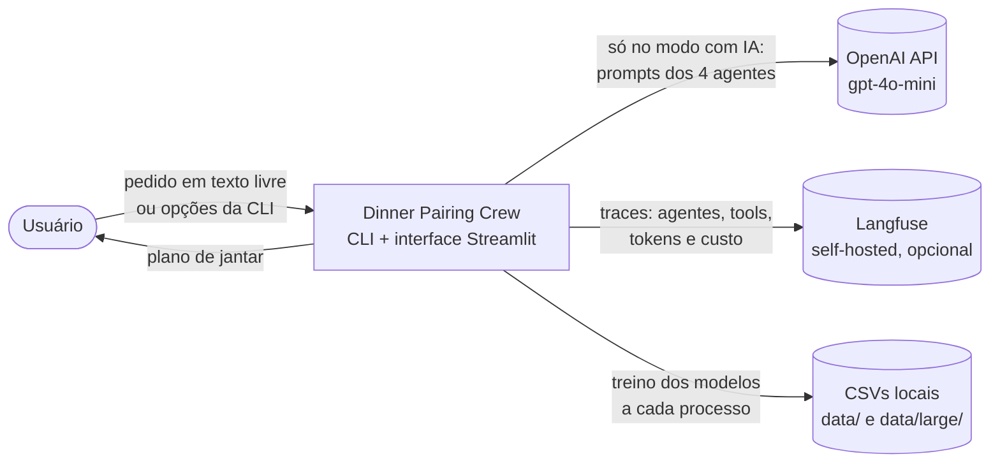
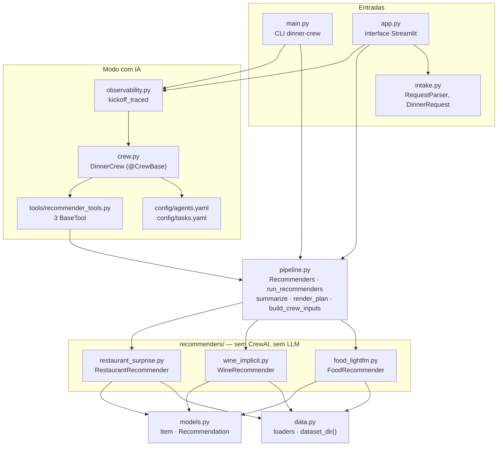
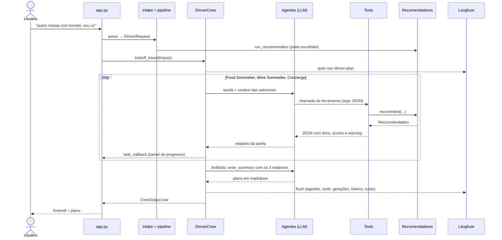
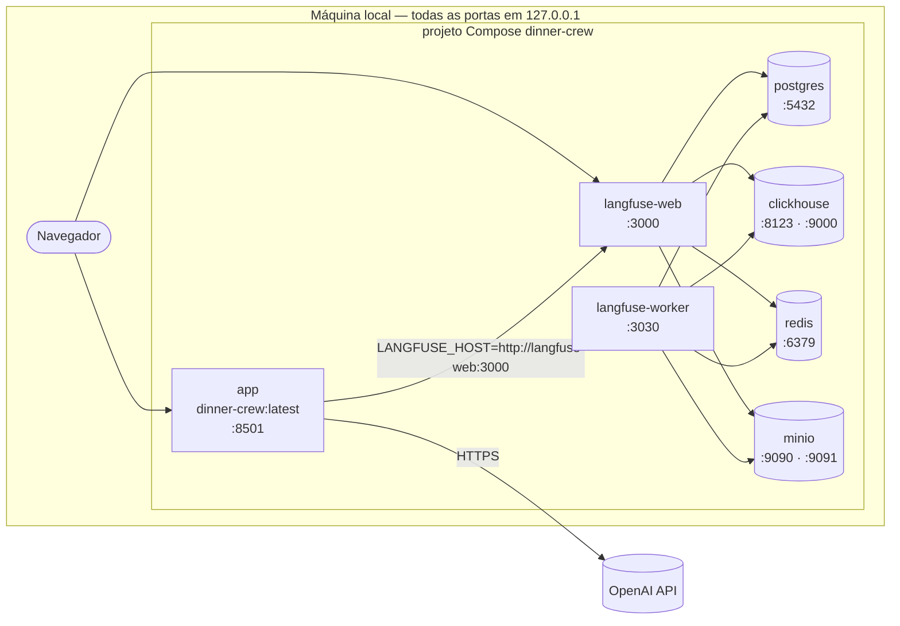
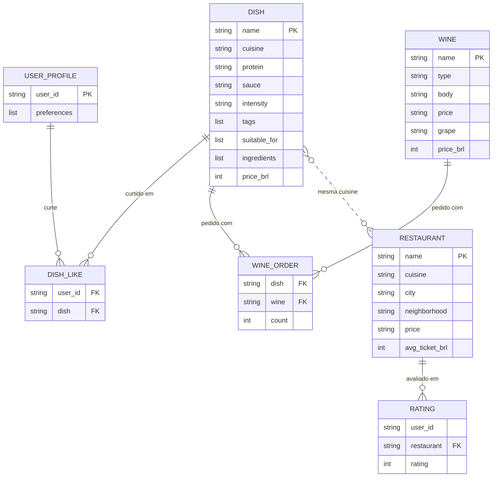

# Referência da arquitetura do software

Cinco visões do sistema, do mais geral ao mais detalhado. O porquê das decisões está em
[Arquitetura do projeto](../explicacao/arquitetura.md); o caminho de um pedido real, com números,
em [Anatomia de um pedido](../explicacao/anatomia-de-um-pedido.md).

## 1. Contexto

Quem usa o sistema e com quais sistemas externos ele fala.

| Sistema externo | Quando é usado | Obrigatório |
|---|---|---|
| OpenAI API | modo com IA (CLI sem `--dry-run`, interface em "Com IA") | só para esse modo |
| Langfuse | modo com IA, com `LANGFUSE_PUBLIC_KEY`/`LANGFUSE_SECRET_KEY` definidas | não |

## 2. Componentes

Os módulos de `src/dinner_crew/` e suas dependências. As setas apontam de quem usa para quem é usado.

| Camada | Módulos | Depende de CrewAI | Depende de LLM |
|---|---|---|---|
| Entradas | `main.py`, `app.py`, `intake.py` | só ao rodar a crew (import tardio) | não |
| Pipeline | `pipeline.py` | não | não |
| Modo com IA | `crew.py`, `config/*.yaml`, `tools/`, `observability.py` | sim | sim |
| Recomendadores | `recommenders/*.py` | não | não |
| Dados | `data.py`, `models.py` | não | não |

## 3. Sequência de um pedido no modo com IA

No modo sem IA, o fluxo termina no terceiro passo: `pipeline.render_plan` escreve o plano a partir
do resultado de `run_recommenders`, sem crew, sem LLM e sem trace.

## 4. Implantação (Docker Compose)

Serviços, imagens, volumes e variáveis: [Referência da instalação Docker](instalacao-docker.md).

## 5. Dados

Os sete arquivos CSV de cada base e como se relacionam. Colunas completas:
[Referência dos arquivos de dados](dados.md).

| Recomendador | Lê |
|---|---|
| LightFM (`FoodRecommender`) | `DISH`, `USER_PROFILE`, `DISH_LIKE` |
| implicit (`WineRecommender`) | `DISH`, `WINE`, `WINE_ORDER` |
| Surprise (`RestaurantRecommender`) | `RESTAURANT`, `RATING` |
