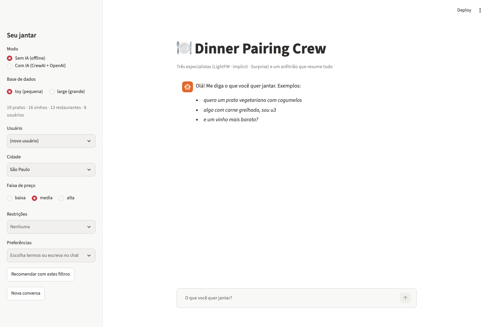
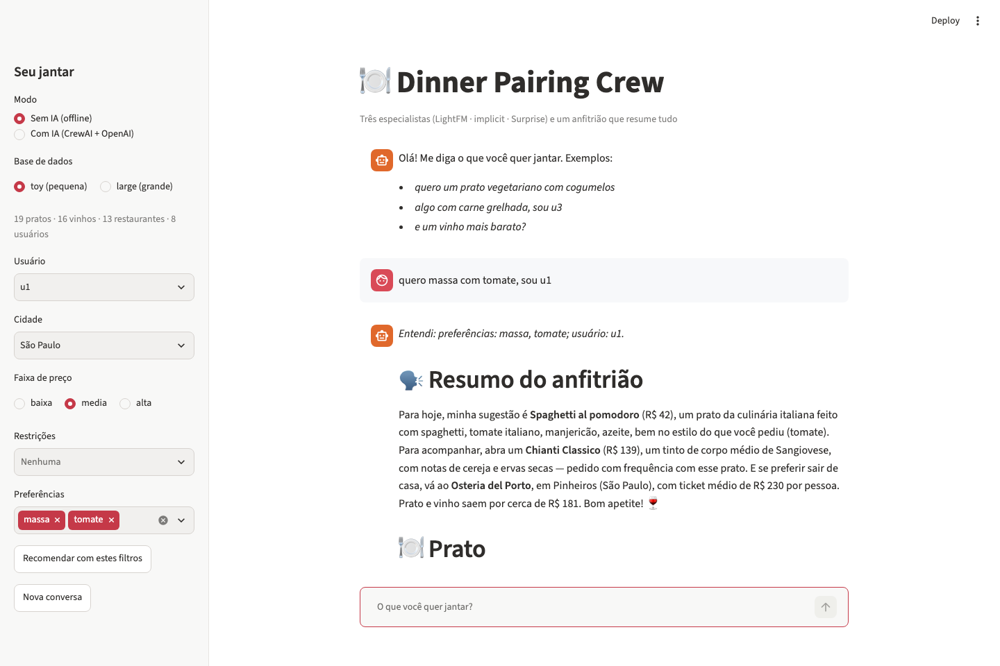
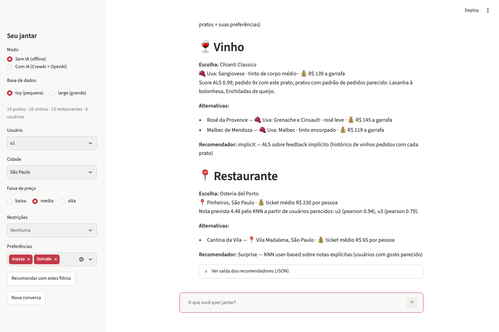
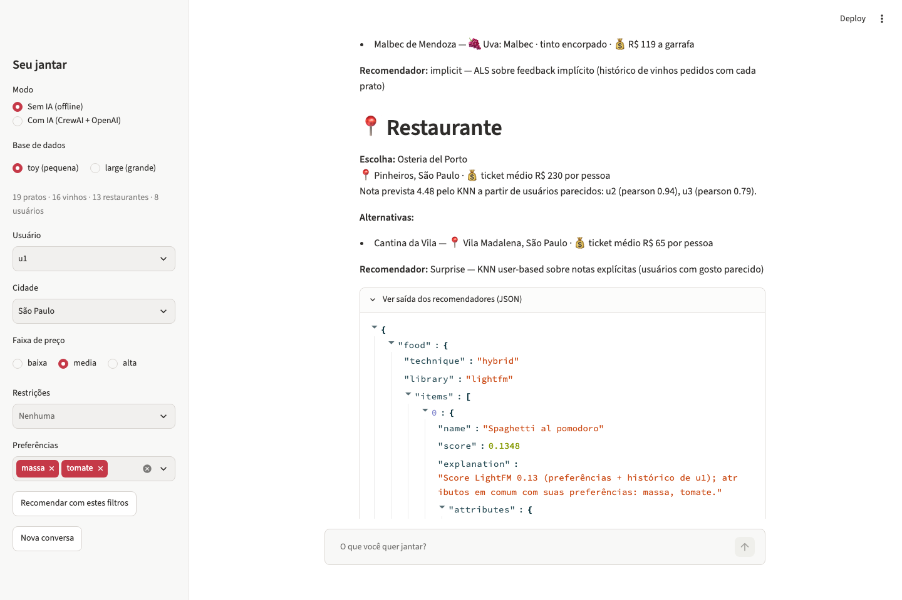
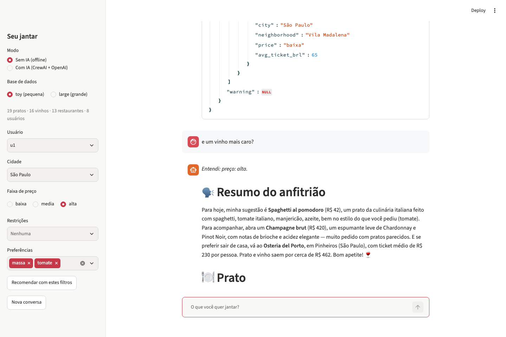
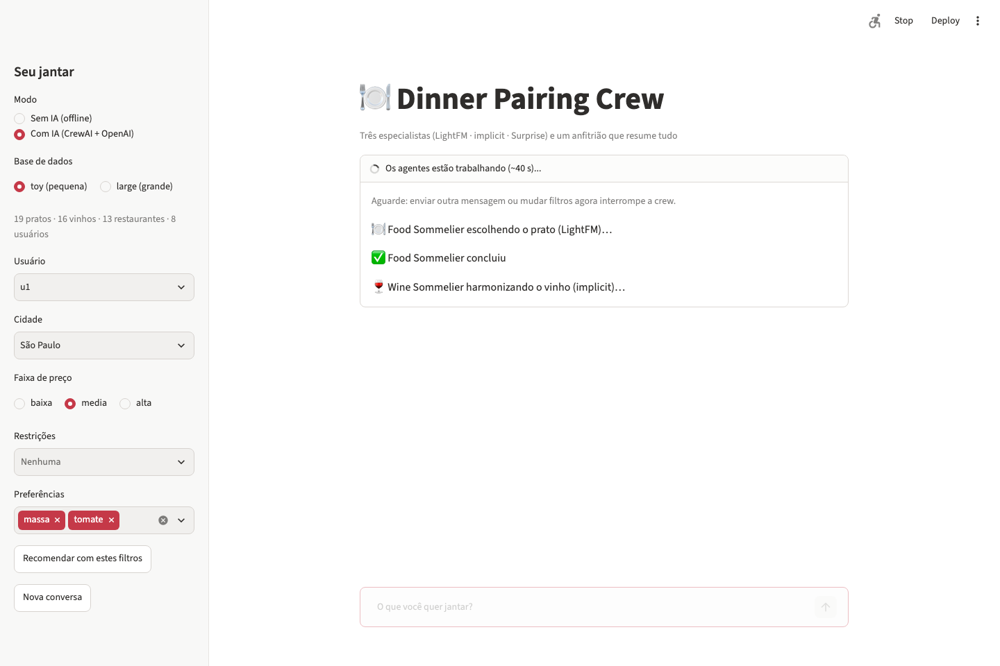
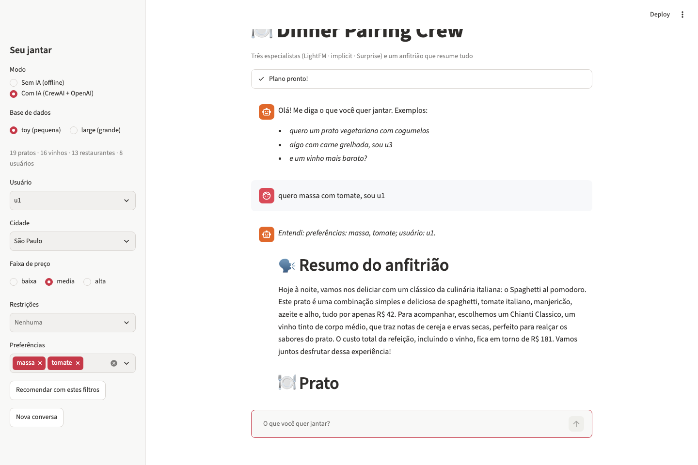
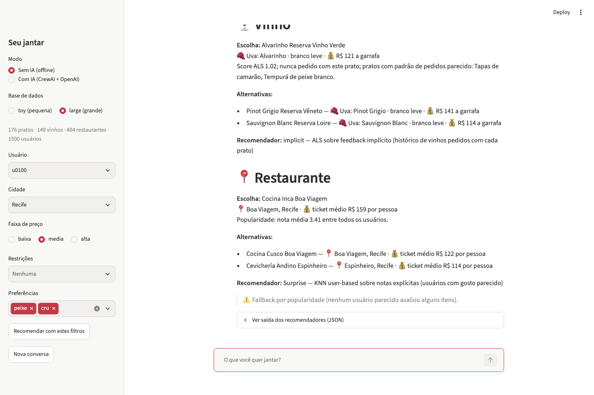
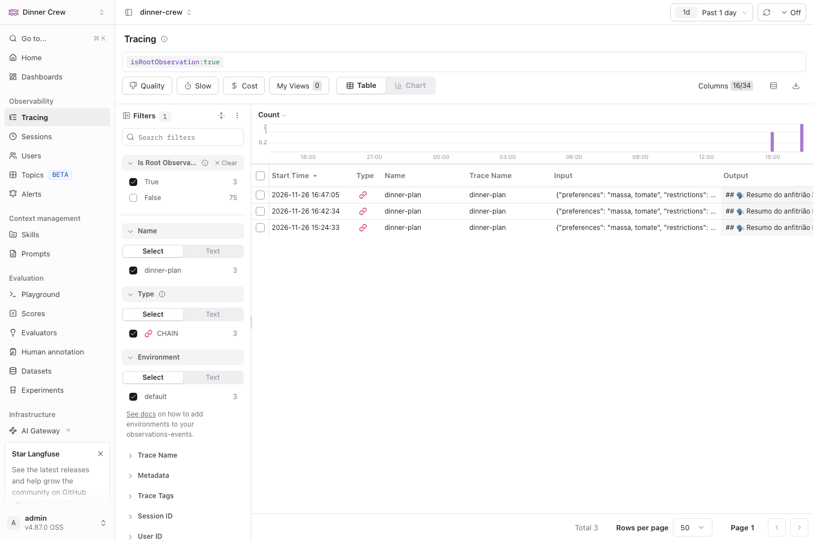

# Referência das telas da interface

Capturas da interface Streamlit (`src/dinner_crew/app.py`) e do Langfuse, feitas na aplicação
rodando via Docker Compose, na base `toy`, com o pedido *quero massa com tomate, sou u1*. Como usar
cada recurso: [Como usar a interface](../guias/como-usar-a-interface.md).

## Tela inicial

| Elemento | Chave de estado | Valor inicial |
|---|---|---|
| **Modo** | `mode` | Sem IA (offline) |
| **Base de dados** | `dataset` | toy (pequena) — a legenda abaixo mostra pratos, vinhos, restaurantes e usuários da base |
| **Usuário** | `user` | (novo usuário) |
| **Cidade** | `city` | São Paulo |
| **Faixa de preço** | `price` | media |
| **Restrições** | `restrictions` | nenhuma |
| **Preferências** | `preferences` | nenhuma; as opções são o vocabulário dos perfis da base |
| **Recomendar com estes filtros** | — | refaz o plano com o painel atual, sem mensagem |
| **Nova conversa** | — | limpa histórico, usuário, preferências, restrições, prato fixado, preço e cidade |
| Caixa de chat | `chat_input` | pedido em texto livre |

## Resposta no modo sem IA — resumo

| Parte | Origem |
|---|---|
| *Entendi: …* | `RequestParser.parse` — o que esta mensagem mudou no pedido |
| **Resumo do anfitrião** | `pipeline.summarize` — template; inclui preços e total prato + vinho |
| Painel lateral | o pedido interpretado escrito nas chaves dos widgets |

## Resposta no modo sem IA — seções

Cada seção (🍽️ Prato, 🍷 Vinho, 📍 Restaurante) traz, nesta ordem: **Escolha** com ingredientes ou
uva e preço; a justificativa do recomendador; **Alternativas** com os mesmos campos; a linha
**Recomendador**; e, se houver, um aviso ⚠️.

## Saída dos recomendadores (JSON)

O conteúdo é o mesmo do `--dry-run` da CLI: `food`, `chosen_dish`, `wine` e `restaurant`, cada um
com `technique`, `library`, `items` e `warning`. Formato:
[Referência do código › models](codigo.md#dinner_crewmodels).

## Refinamento

A mensagem é lida por cima do pedido anterior: só `price` muda. Na base `toy`, o vinho passa a ser o
Champagne brut, com aviso de sinal fraco na seção do vinho.

## Modo com IA — progresso

Atualizado pelo `task_callback` da crew: uma linha ao começar e outra ao concluir cada um dos quatro
agentes. Ao fim, o rótulo vira **Plano pronto!** (ou **A crew falhou**, com o erro no chat).

## Modo com IA — resposta do Anfitrião

Mesmos itens do modo sem IA; o texto é escrito pelo agente Anfitrião (tarefa `write_summary`).

## Base grande

Ao trocar de base, valores que não existem na nova base (usuário, cidade, preferências, prato fixado)
são limpos.

## Langfuse — lista de traces

Projeto **dinner-crew** → **Tracing**. Cada linha é um pedido feito no modo com IA (trace
`dinner-plan`).

## Langfuse — um trace aberto

| Área | Conteúdo |
|---|---|
| Cabeçalho | duração, custo total, tokens, sessão, usuário e tags (`streamlit`/`cli`, `toy`/`large`) |
| Árvore (**Tree**) | `dinner-plan` → `DinnerCrew.kickoff` → agentes → gerações e ferramentas; cada nó com duração e, nas gerações, custo |
| Painel direito | **Input** (os placeholders enviados à crew) e **Output** (o plano final) do nó selecionado |

Como ler um trace: [Sobre a observabilidade](../explicacao/observabilidade.md).
