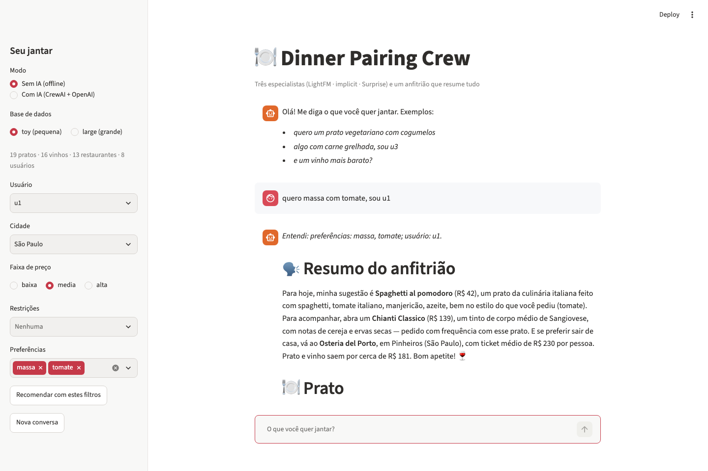
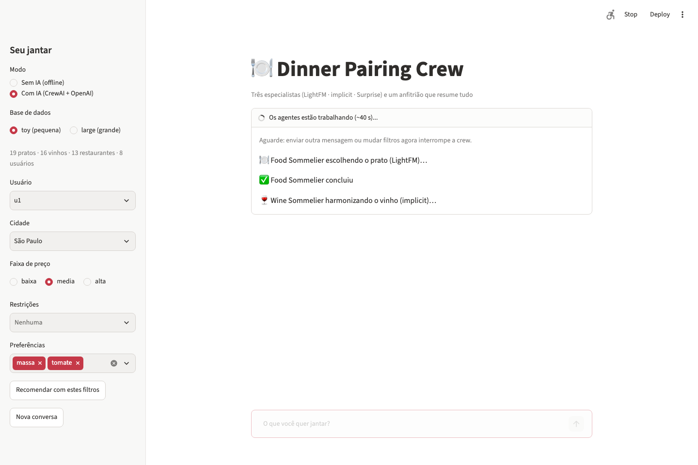
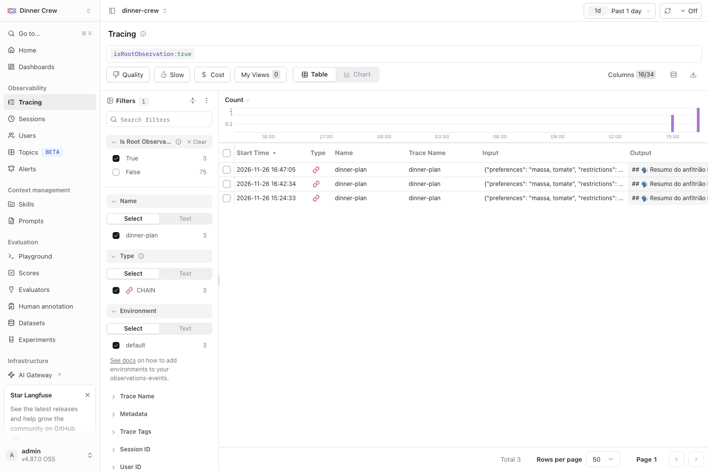
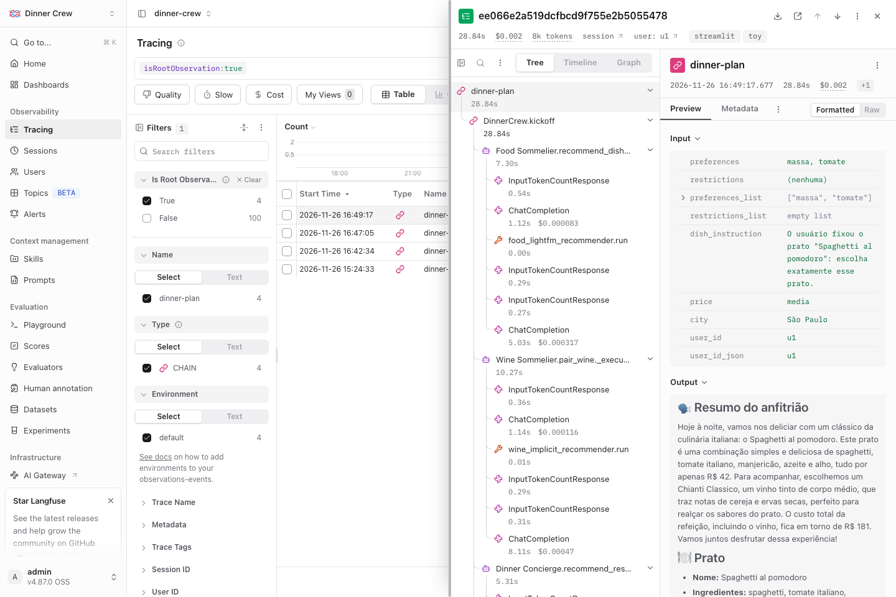

# Seu primeiro jantar com IA, monitorado no Langfuse

Neste tutorial você vai subir a aplicação completa com Docker, pedir um jantar em português no chat,
deixar os quatro agentes de IA trabalharem e depois abrir o Langfuse para ver, passo a passo, o que
cada agente fez — quais ferramentas chamou, o que o modelo respondeu e quanto custou.

**Tempo:** ~20 minutos (mais o download das imagens na primeira vez).
**Pré-requisitos:** Docker Desktop aberto, ~10 GB livres em disco, `uv` instalado, o repositório
clonado e uma chave da OpenAI. Se você nunca rodou o projeto, faça antes
[Primeiros passos](primeiros-passos.md).

## 1. Coloque sua chave da OpenAI

Na raiz do repositório:

```bash
cp .env.example .env
```

Abra `.env` e preencha `OPENAI_API_KEY=sk-...`.

## 2. Gere as chaves do Langfuse

```bash
uv run python scripts/setup_langfuse_env.py
```

Você verá algo como:

```text
Criado infra/langfuse/.env (login: admin@dinner-crew.local / Xy3...)
Chaves do Langfuse adicionadas ao .env
```

Anote o login. Se perder, ele está em `infra/langfuse/.env`.

## 3. Suba tudo

```bash
docker compose up -d --build
```

Na primeira vez isso baixa as imagens e constrói a da aplicação — leva alguns minutos. Depois,
confira:

```bash
docker compose ps
```

Espere até ver `app` e `langfuse-web` com `(healthy)`:

```text
SERVICE           STATE     STATUS
app               running   Up 10 seconds (healthy)
langfuse-web      running   Up 27 seconds (healthy)
...
```

## 4. Peça um jantar sem IA

Abra http://localhost:8501. No painel lateral, deixe **Modo** em **Sem IA (offline)** e escreva no
chat:

```text
quero massa com tomate, sou u1
```

Em um segundo aparece a resposta. Repare em três coisas:

- a primeira linha diz o que foi entendido: `Entendi: preferências: massa, tomate; usuário: u1.`;
- o **Resumo do anfitrião** sugere **Spaghetti al pomodoro** (R$ 42), **Chianti Classico**
  (R$ 139) e a **Osteria del Porto**, e soma prato + vinho: R$ 181;
- no painel lateral, **Usuário** mudou sozinho para `u1` e **Preferências** ganhou `massa` e
  `tomate`.

Tudo isso veio só dos três recomendadores, sem nenhuma IA.



## 5. Agora peça com IA

No painel, mude **Modo** para **Com IA (CrewAI + OpenAI)** e envie de novo:

```text
quero massa com tomate, sou u1
```

Um painel de progresso aparece. **Não mexa em nada enquanto ele roda** (≈40 s). Você verá as linhas
surgindo:

```text
🍽️ Food Sommelier escolhendo o prato (LightFM)…
✅ Food Sommelier concluiu
🍷 Wine Sommelier harmonizando o vinho (implicit)…
✅ Wine Sommelier concluiu
📍 Concierge procurando o restaurante (Surprise)…
✅ Dinner Concierge concluiu
🗣️ Anfitrião escrevendo o resumo…
✅ Anfitrião do Jantar concluiu
```



O painel fecha em **Plano pronto!** e a resposta chega. Compare com a do passo 4: os itens são os
mesmos (vêm dos mesmos recomendadores), mas o texto agora foi escrito pelo agente Anfitrião, com
frases mais naturais.

## 6. Refine o pedido

Ainda no modo com IA, envie:

```text
e um vinho mais caro?
```

A primeira linha da resposta diz `Entendi: preço: alta.` — só o preço mudou; prato, usuário e
cidade continuaram os mesmos. O vinho agora é o **Champagne brut**, e a seção do vinho traz um
aviso:

```text
⚠️ Sinal fraco (score -0.05): nenhum vinho desta faixa costuma ser pedido com pratos parecidos.
```

O recomendador encontrou um vinho caro, mas avisa que o histórico de pedidos não sustenta bem essa
combinação — em vez de fingir confiança.

## 7. Abra o Langfuse

Abra http://localhost:3000 e entre com o login do passo 2. Clique no projeto **dinner-crew** e
depois em **Tracing**.



Você verá dois traces chamados `dinner-plan` — um para cada pedido feito com IA. Os pedidos sem IA
não aparecem: eles não chamam o modelo.

## 8. Leia um trace

Clique no trace mais antigo. À esquerda aparece uma árvore como esta (os nós
`InputTokenCountResponse`, contagens de tokens que o CrewAI faz antes de chamar o modelo, foram
omitidos):

```text
dinner-plan                                         [CHAIN]
└── DinnerCrew.kickoff                              [CHAIN]
    ├── Food Sommelier.recommend_dish               [AGENT]
    │   ├── ChatCompletion                          [GENERATION]  o agente decide chamar a ferramenta
    │   ├── food_lightfm_recommender.run            [TOOL]        o LightFM responde
    │   └── ChatCompletion                          [GENERATION]  o agente escreve o relatório
    ├── Wine Sommelier.pair_wine                    [AGENT]
    │   ├── ChatCompletion
    │   ├── wine_implicit_recommender.run           [TOOL]
    │   └── ChatCompletion
    ├── Dinner Concierge.recommend_restaurant       [AGENT]
    │   ├── ChatCompletion
    │   ├── restaurant_surprise_recommender.run     [TOOL]
    │   └── ChatCompletion
    └── Anfitrião do Jantar.write_summary           [AGENT]
        └── ChatCompletion                          [GENERATION]  sem ferramenta: só escreve
```

Repare no padrão de cada especialista: uma chamada ao modelo para decidir usar a ferramenta, a
ferramenta, e outra chamada para escrever o relatório. O Anfitrião só tem a última.



Explore três nós:

1. **`dinner-plan`** (a raiz): em *Input* estão os valores enviados à crew (preferências, usuário,
   preço); em *Output*, o plano final. No topo aparecem o usuário `u1` e a sessão do chat.
2. **`food_lightfm_recommender.run`**: em *Input*, os argumentos que o agente passou para a
   ferramenta (`["massa", "tomate"]`, `u1`); em *Output*, o JSON com os três pratos e seus scores.
3. **Um `ChatCompletion`**: o prompt completo que o CrewAI montou, a resposta do modelo, os tokens
   e o custo dessa chamada.

Agora abra o segundo trace (o do vinho mais caro): ele está na mesma **sessão**, e o
`wine_implicit_recommender.run` recebeu `price: "alta"`.

## O que você fez

Você subiu a aplicação e o Langfuse com um comando, pediu um jantar sem e com IA, refinou o pedido
em linguagem natural e usou o Langfuse para ver exatamente o que cada agente fez, com que dados e a
que custo.

## Próximos passos

- Entenda o caminho completo de um pedido: [Anatomia de um pedido](../explicacao/anatomia-de-um-pedido.md).
- Entenda o que os traces mostram e por quê: [Sobre a observabilidade](../explicacao/observabilidade.md).
- Para parar tudo: `docker compose down` (os dados do Langfuse são mantidos).
